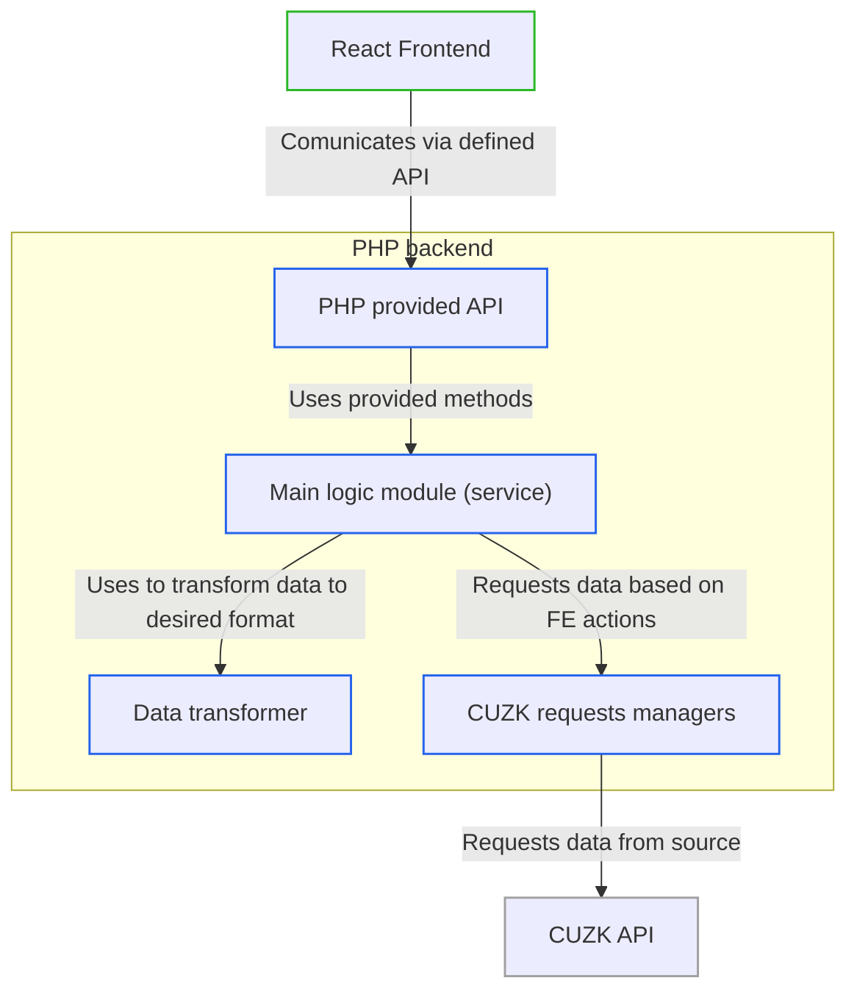

# Parcel Map Application

Application serves for displaying cadastral parcels in Jičín's neighbourhood and potentially more. It allows user to see how the land is divided into the parcels and see details of individual parcels.

App consists of PHP native backend and React frontend. Its components are visualized on following simplified architecture graph:



## Local deployment / Development environment

### Backend

Start backend for local development in `/backend` folder by running:

```bash
php -S localhost:8000 -t public public/index.php
```

### Frontend

Start frontend for local development in `/frontend` folder by running:

```bash
npm run dev
```

The app can be found on `http://localhost:5173/` ready after both are started.

FE should communicate with running BE automatically in local development mode. Before complete deployment `.env` variable needs to be configure to point to correct address and port or other solution needs to be introduced.

## Technologies

Follows list of used technologies in project.

- **OpenAPI 3.0.3**: For specification of communication between BE and FE. Right now code is generated only for FE directly from the spec. For BE the spec serves mostly as a reference.

### Backend

- **PHP 8.5.12** 

### Frontend

- **React ^19.3.1** (with TypeScript)
- **Vite ^8.3.6**: project dependencies
- **TailwindCSS ^4.3.5**: styling
- **OpenAPI-Fetch ^0.17.0**: generating interfaces and types from OpenAPI spec
- **OpenLayers ^10.11.0**: map provider


