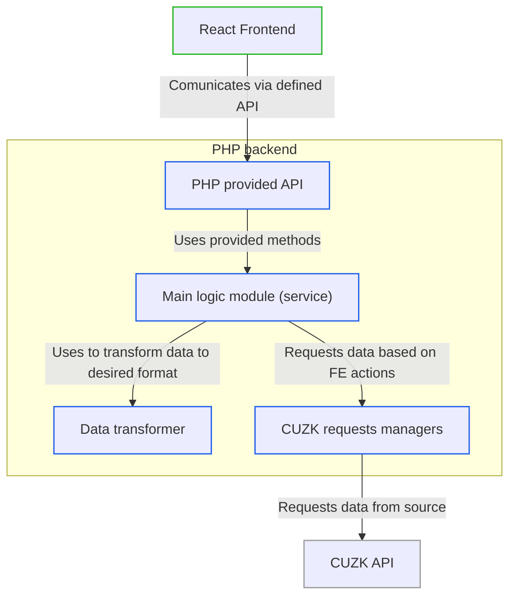

# Parcel Map Application

Application serves for displaying cadastral parcels in Jičín's neighbourhood and potentially more. It allows user to see how the land is divided into the parcels and see details of individual parcels.

App consists of PHP native backend and React frontend. Its components are visualized on following simplified architecture graph:



## Local deployment / Development environment

### Backend

Start backend for local development in `/backend` folder by running:

```bash
php -S localhost:8000 -t public public/index.php
```

### Frontend

Start frontend for local development in `/frontend` folder by running:

```bash
npm run dev
```

The app can be found on `http://localhost:5173/` ready after both are started.

FE should communicate with running BE automatically in local development mode. Before complete deployment `.env` variable needs to be configured to point to correct address and port or other solution needs to be introduced.

## Technologies

Follows list of used technologies in project.

- **OpenAPI 3.0.3**: For specification of communication between BE and FE. Right now code is generated only for FE directly from the spec. For BE the spec serves mostly as a reference.

### Backend

- **PHP 8.5.12** 

### Frontend

- **React ^19.3.1** (with TypeScript)
- **Vite ^8.3.6**: project dependencies
- **TailwindCSS ^4.3.5**: styling
- **OpenAPI-Fetch ^0.17.0**: generating interfaces and types from OpenAPI spec
- **OpenLayers ^10.11.0**: map provider

## Task diary (in Czech only, sorry)

### Rozdhodnutí

- OpenAPI na definici komunikace mi příjde jako dobrý nástroj pro zachování konzistence mezi BE a FE, bohužel tak jak jej používám normálně (generování BE a FE interfaců a typů) se mi ho na BE nepodařilo zprovoznit.

- Rozhold jsem se pro variantu tahání data z ČÚZK serverů za běhu, rozhodl jsem se tak kvůli pozdějším aktualizacím parcel, které budou takto pro nás zadarmo (bez změn našeho kódu).
    - Je třeba uznat, že pro tuto variantu není BE moc důležitý a aplikace by do značné míry mohla fungovat bez něj, pokud by si FE tahal data přímo z ČÚZK a transformoval si je sám. Toto nebyl záměr, ale časem to vyplynulo při řešení úlohy.

- Protože byl FE bez omezení, tak jsem se rozhodl pro svůj nejpoužívanější stack.

- Pozdějí jsem se po analýze ČÚZK endpointů a jejich možností rozhodl pro **WGS 84 / Pseudo-Mercator (3857)** souřadnicový systém, u kterého je výhodou, že jej OpenLayers dokáží bez další transformace. Jedná se o výchozí souřadnicový systém.

- Rozhodnutí použít při menším zoomu obrysy obcí bylo od začátku čistě kvůli performace. Zdá se mi to lepší než varianta nezobrazovat nic.

- Získávat vždy parcely z daného boxu jsem vybral kvůli dobré kompatibilitě se zobrazením na obrazovce.

- Později jsem se rozhodl přistupovat pouze k polygonům parcel místo všech dat zároveň pro zrychlení zisku dat. Díky tomu jsem musel vrátit do aplikace hledání infa o parcele pomocí souřadnic kliknutí.

### Co by chtělo nebo se mohlo řešit jinak

- Uvažoval jsem nad workflow: Získat polygon obce (uložený u nás pro všechny obce Jičínského okresu), a poté se dotázat na něj. To by více sedělo na rozdělení okresu na obce při menším zoomu. Možnost se mi celkem líbila, oblasti by ale stále byly příliš velké, takže by se načítaly pomalu. To jsem nedokázal vyřešit. 

- Určitě velkou možností, která ve výsledku bude asi i lepší, je stáhnou všechny parcely v okresech. Ty uschovat na BE ve formátu, který nám vyhovuje a poté se dotazovat na ně. To by nejspíš výrazně zlepšilo rycholost načítání parcel. Podle zvoleného formátu se datasety ve službě aktualizují různě často, po každé aktualizaci bychom mohli automaticky stáhnout novou verzi na BE a transformovat jí podle našich potřeb. Výměnnou za rychlost bychom museli dataset uchovávat a aktualizovat. Bylo by nutné více analyzovat velikost potřebných datasetů a co je pro nás lepší. 
    - Také je možné, že datasety aktualizované jednou za časový úsek jsou nějakou dobu před aktualizací zastaralé. Na první pohled se zdá, že INSPIRE služby jsou aktuální stále. Také by bylo třeba analyzovat jak moc nás toto omezuje.

- Optimalizace performace je stálem problémem. Uritě by se dala například vylepšit cache, nebo zkusit nějak chytře získávat data z oblastí kolem toho, kde uživatel právě je, aby se pak načetla rychleji. Také by šlo přidat něco jako načítání po chunk-cích.

- Líbilo by se mi mít nastavení věcí jako URL serverů a jméno oblasti v samostatném `config` souboru.

- Určitě bych používal pro vývoj ve větším týmu issues. Pro vývoj striktně samostatně si ale obdobu řeším lokálním TODO listem a příjde mi to jednodušší a rychlejší. 

### Plusy

- Aplikace je použitelná.

- Aplikace pokrývá celý okres Jičín a rozšit jí na celou ČR dá minimální práci. Vlastně stačí upravit, co se bude dít při nižším zoomu. Parcely se budou načítat automaticky kdekoliv.

- Aplikace načítá aktuální data z ČÚZK a není třeba jí aktualizovat do budoucna, pokud nedojde ke změně API, což se neočekává.

### Mínusy

- Aplikaci stále trvá trochu delší dobu načít oblasti s hodně parcelami jako centra měst.

- Aplikace nemá testy. To je hlavně nedostatkem času.

- Aplikace nemá neprůstřelnou dokumentaci a mohla by být lépe okomentovaná. To je také hlavně nedostatkem času.

- Zobrazená data detailů parcel jsou značně omezená a po konzultaci s doménovými odborníky by stálo za to je změnit / přidat.

### Použití AI

#### Při práci na aplikaci **nebyl** použit žádný AI nástroj v těchto oblastech:

- Na analýzu zadání
- Na návrh architektury
- Na výběr endpointů ČÚZK a návrh jejich využití v aplikaci
- Na definici OpenAPI specifikace
- Na definici komponent, tříd a sygnatury metod

#### Při zpracování aplikace **byl** dále používán GitHub Copilot (a ChatGPT) a to konkrétně:

- Na konzultaci specifických technologií (dokumentace)
- Na implementaci / částečnou implementaci některých částí kódu
- Na interaktivní bugfixing
- Na implementaci FE cache v mapě

### Časová náročnost

Do řešení úkolu jsem se celkem zabral a poté mi to už nedalo a chtěl jsem doručit rozumný výsledný produkt. Díky tomu, a také tomu, že jsem na začátku některé věci zvolil trochu hůř a musel jsem je později opravovat, jsem nad projektem strávil více času, než bylo doporučeno. Celkový odhad: **20 hodin**.

Odhad rozpadu na jednotlivé činnosti:

- Analýza zadání a datových zdrojů: **4 hodiny** (i s dodatečnými úpravami)

- Návrh architektury: **3 hodiny** (i s dodatečnými úpravami)

- Konfigurace projektu: **1 hodina**

- Implementace BE: **5 hodin**

- Implementace FE: **6 hodin**

- Dokumentace: **1 hodina**